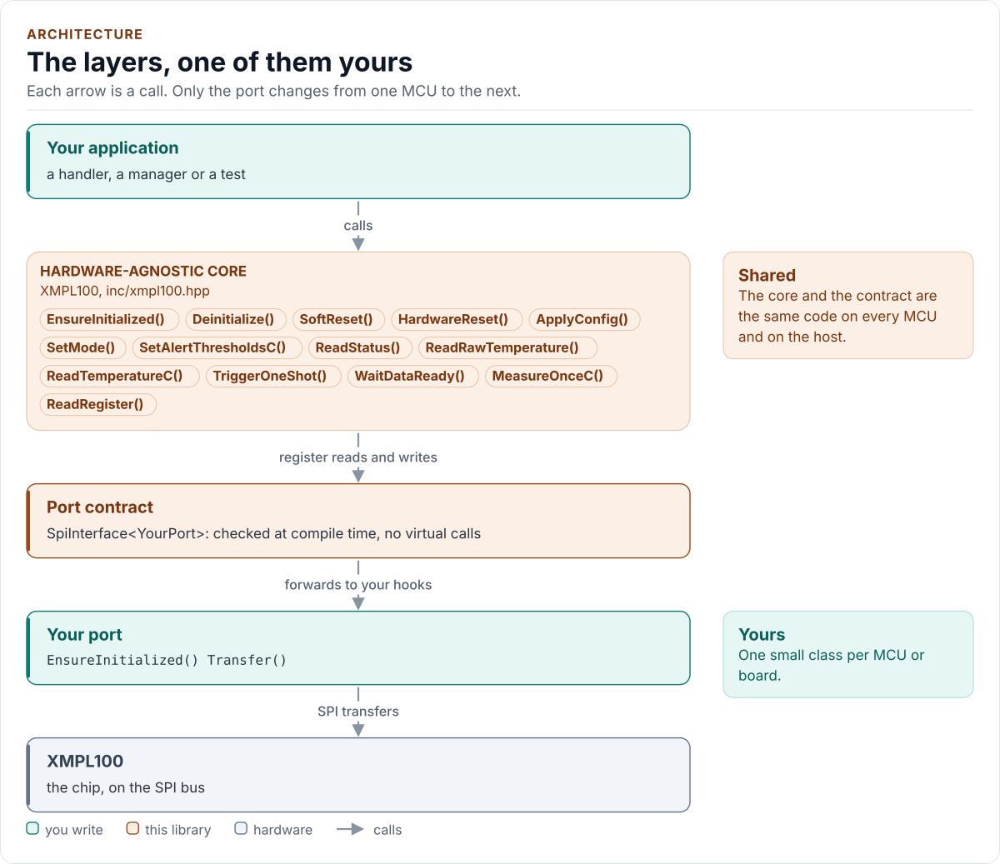
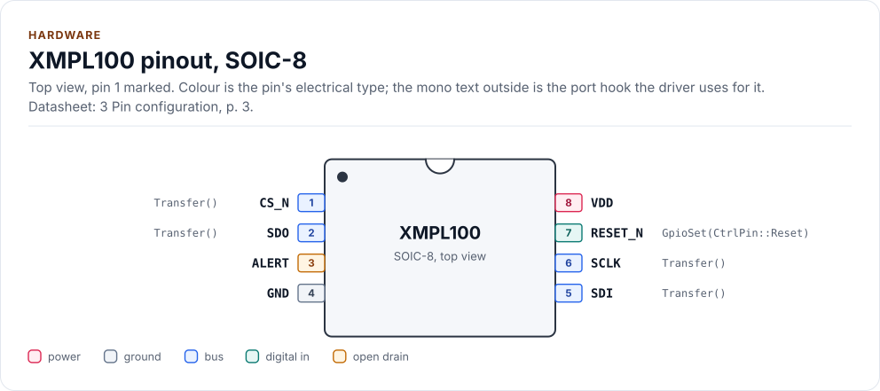
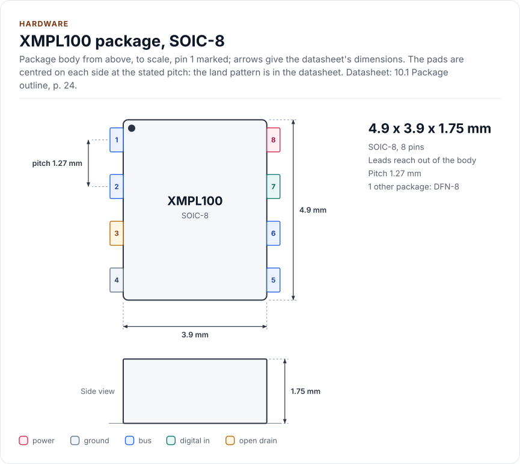
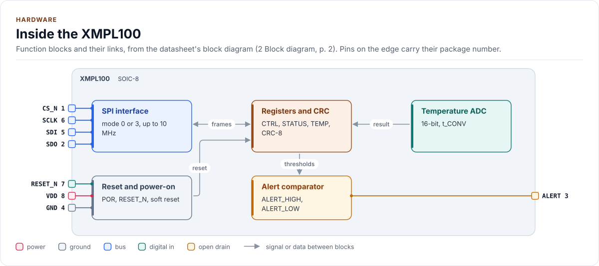

# XMPL100 Driver

C++20 driver for the XMPL100, a fictional example SPI temperature sensor: chip ID, one-shot and continuous reads, CRC.

[](https://github.com/kokeb-labs/driver-template/actions/workflows/ci.yml)
[](LICENSE)
[](docs/installation.md#requirements)

**Documentation: [`docs/`](docs/index.md)**, with the API reference built by Doxygen ([how](docs/api-reference.md)).
The site at <https://kokeb-labs.github.io/driver-template/> opens when the repository is public.

<!-- scaffold:remove -->
> This is the template for drivers and libraries. Create a repository from it and run `python3 tools/setup.py`:
> see [Using the template](docs/template.md).
<!-- /scaffold:remove -->

The XMPL100 measures the temperature of its own die, from -40 °C to +125 °C in steps of 1/128 °C, and raises an
alert pin when it leaves a window you set. This driver starts it safely, reads it continuously or on demand, checks
the CRC of every result and turns the chip's status flags into errors you can act on. It runs on any MCU: you give
it a small class that moves bytes on your bus, and it does the rest.

<!-- figure: driver-layers -->
<picture>
  <source media="(prefers-color-scheme: dark)" srcset="docs/diagrams/driver-layers.dark.svg">
  
</picture>
<!-- /figure -->

## At a glance

<!-- scaffold:readme-glance -->
| | |
| --- | --- |
| **Chip** | XMPL100 digital temperature sensor, 1.8 V to 3.6 V |
| **Measures** | Die temperature, -40 °C to +125 °C, 16-bit result at 1/128 °C per count |
| **Bus** | SPI mode 0 or 3, up to 10 MHz; 7-bit register addresses with auto-increment |
| **Also drives** | The open-drain ALERT pin (high and low thresholds); RESET_N, when your port has `GpioSet()` |
| **Driver** | Header-only C++20; no heap, exceptions, RTTI or virtual calls; every call returns `Result<T>` |
| **Runs on** | Any MCU with SPI and a C++20 compiler; the host example runs on any PC ([Platforms](docs/platforms.md)) |
| **Status** | 0.1.0, not yet verified on hardware: host-tested against a register model of the chip |
<!-- /scaffold:readme-glance -->

<!-- figure: chip-pinout -->
<picture>
  <source media="(prefers-color-scheme: dark)" srcset="docs/diagrams/chip-pinout.dark.svg">
  
</picture>
<!-- /figure -->

<!-- figure: chip-outline -->
<picture>
  <source media="(prefers-color-scheme: dark)" srcset="docs/diagrams/chip-outline.dark.svg">
  
</picture>
<!-- /figure -->

<!-- figure: chip-blocks -->
<picture>
  <source media="(prefers-color-scheme: dark)" srcset="docs/diagrams/chip-blocks.dark.svg">
  
</picture>
<!-- /figure -->

<!-- generated: chip-card -->
| | | Datasheet |
| --- | --- | --- |
| **Package** | SOIC-8 | 3, p. 3 |
| **Pins** | 8 | 3, p. 3 |
| **Body size** | 4.9 x 3.9 x 1.75 mm | 10.1, p. 24 |
| **Pin pitch** | 1.27 mm | 10.1, p. 24 |
| **Variants** | `dfn` (below) | 11, p. 26 |
| **Supply VDD** | 1.8 V to 3.6 V | 5, p. 5 |

Also sold as:

| Variant | Package | Pins | Size | Ordering | Note | Datasheet |
| --- | --- | --- | --- | --- | --- | --- |
| `dfn` | DFN-8 | 8 | 3.0 x 3.0 x 0.8 mm | XMPL100D | exposed pad to GND | 11, p. 26 |

From [`docs/hardware.yml`](docs/hardware.yml); pins, circuits and the block diagram: [Hardware](docs/hardware.md).
<!-- /generated -->

## Datasheet

<!-- generated: datasheet-card -->
| Document | Revision | Get it |
| --- | --- | --- |
| Datasheet: XMPL100 Digital Temperature Sensor (Example Corp (fictional) XMPL100-DS) | A, 2026-11-06 | [vendor page](https://example.com/xmpl100) |

Written against these revisions; the SHA-256 of each file is in [`docs/datasheets.yml`](docs/datasheets.yml). Where each
part of the driver is in the datasheet: [Datasheet map](docs/datasheet.md).
<!-- /generated -->

Every docs page lists the datasheet sections it relies on, and code comments cite the section they implement.

## Try it on your PC

No hardware needed: [`examples/host`](examples/host/README.md) runs the driver against a simulated chip.
You need git, CMake 3.16+ and a C++20 compiler (GCC 10+, Clang 13+ or MSVC 2022).

1. Get the source:

   ```bash
   git clone https://github.com/kokeb-labs/driver-template.git && cd driver-template
   ```

2. Build and run the example:

   ```bash
   cmake -S examples/host -B build-example
   cmake --build build-example
   ./build-example/xmpl100_host_example
   ```

3. You should see the driver start the simulated chip and read it three times:

   ```text
   XMPL100 driver 0.1.0 on the host
   xmpl100: initialised
   25.00 C
   25.00 C
   25.00 C
   ```

To run the whole test suite instead: `cmake -S . -B build -DXMPL100_BUILD_TESTS=ON && cmake --build build && ctest
--test-dir build`.

## Use it on your MCU

**1. Wire it** ([Hardware](docs/hardware.md) has every pin, the timing and the power):

<!-- scaffold:bus-wiring -->
| MCU | XMPL100 | Notes |
| --- | --- | --- |
| SPI SCLK | SCLK | Mode 0 or 3, up to 10 MHz; 1 MHz for bring-up on jumper wires |
| SPI MOSI | SDI | |
| SPI MISO | SDO | High impedance while CS_N is high, so the bus can be shared |
| GPIO (chip select) | CS_N | Low for the whole frame: one transfer per frame |
| 3.3 V | VDD | 1.8 V to 3.6 V; 100 nF to GND close to the pin |
| GND | GND | |
<!-- /scaffold:bus-wiring -->

<!-- scaffold:readme-port -->
**2. Write the port**: a class with `EnsureInitialized()` (bring the bus up), `Transfer()` (one full-duplex frame
with CS_N low) and `DelayUs()`, about 20 lines on most SDKs. [Porting](docs/porting.md) has the contract and a
complete example.
<!-- /scaffold:readme-port -->

**3. Read the temperature:**

<!-- generated: quickstart-code -->
```cpp
#include "xmpl100.hpp"

int read_board_temperature(MyPort& port, float& celsius) {
  xmpl100::XMPL100<MyPort> sensor(port); // no I/O yet

  if (auto r = sensor.EnsureInitialized(); !r) { // 1. bus up, reset, CHIP_ID, Config{}
    return static_cast<int>(r.error); //    Bus, Timeout or DeviceIdMismatch: check wiring
  }
  const auto t = sensor.ReadTemperatureC(); // 2. latest continuous result
  if (!t) {
    return static_cast<int>(t.error); //    DeviceFault: sensing element open or shorted
  }
  celsius = t.value; // 3. degrees Celsius, 1/128 °C resolution
  return 0;
}
```
<!-- /generated -->

`EnsureInitialized()` is the only call that starts the chip. Every other call returns `Error::NotInitialized`
until it has succeeded, and no read ever starts the chip on its own.

## What it does

- Brings the chip up with a soft reset and a CHIP_ID check; nothing touches the chip before that succeeds.
- Reads the temperature in continuous mode, or one conversion on demand, with a bounded wait.
- Checks the CRC-8 of every result on revision B silicon and reports sensor faults.
- Programs the alert thresholds and the offset from a `Config` with datasheet defaults and three presets.
- Returns `Result<T>` with an `Error` from every call: no exceptions, no heap, no RTTI, no virtual calls.

## Add it to your project

Pick the row that matches your build; each is a few steps, and [Installation](docs/installation.md) has the
details.

<!-- scaffold:readme-picker -->
| Your build | Steps below |
| --- | --- |
| Plain CMake: STM32 (CubeMX), RP2040 (Pico SDK), nRF Connect, a host app | [A](#a-cmake-any-mcu) |
| ESP-IDF | [B](#b-esp-idf) |
| An SDK or OS image that installs libraries | [C](#c-installed-package) |
<!-- /scaffold:readme-picker -->

### A. CMake, any MCU

1. Add the driver as a submodule, pinned to the version you chose:

   ```bash
   git submodule add https://github.com/kokeb-labs/driver-template.git external/driver-template
   ```

2. In your `CMakeLists.txt`, after `project()`:

   ```cmake
   add_subdirectory(external/driver-template)
   target_link_libraries(my_app PRIVATE xmpl100::xmpl100)   # brings the headers and C++20
   ```

3. In your code, `#include "xmpl100.hpp"`, write the port ([Porting](docs/porting.md)) and build. A first build
   that compiles the quickstart above is the check that the driver is wired in.
<!-- scaffold:platform-esp32 -->

### B. ESP-IDF

1. Add the driver under your project's `components/`; ESP-IDF finds it there and names it after the folder:

   ```bash
   git submodule add https://github.com/kokeb-labs/driver-template.git components/xmpl100
   ```

2. In `main/CMakeLists.txt`, list it: `idf_component_register(SRCS "main.cpp" REQUIRES xmpl100)`.
3. `idf.py menuconfig` now has a **XMPL100 temperature sensor** menu (data rate, averaging, CRC, timeout),
   and `idf.py build` builds the driver with your app. [`examples/esp32`](examples/esp32) is a complete
   project with a port for the board.
<!-- /scaffold:platform-esp32 -->

### C. Installed package

1. Install it once into a prefix:

   ```bash
   cmake -S external/driver-template -B build-xmpl100 && cmake --install build-xmpl100 --prefix /opt/sdk
   ```

2. In your project, with `CMAKE_PREFIX_PATH=/opt/sdk`:

   ```cmake
   find_package(xmpl100 0.1 REQUIRED)
   target_link_libraries(my_app PRIVATE xmpl100::xmpl100)
   ```

The target is `xmpl100::xmpl100` every way, so switching later changes nothing else.

## Documentation

| Page | Read it when you want to |
| --- | --- |
| [Quickstart](docs/quickstart.md) | Go from a bare chip to a temperature on your MCU |
| [Hardware](docs/hardware.md) | Wire it, check the bus settings, the timing and the power |
| [Porting](docs/porting.md) | Write the port class for your MCU's SDK |
| [API guide](docs/api-guide.md) | Use each call: start, configure, measure, set alerts, handle errors |
| [Configuration](docs/configuration.md) | Choose every setting, or start from a preset |
| [Troubleshooting](docs/troubleshooting.md) | Find the cause of an error or a wrong reading |
| [Contract](docs/contract.md) | Know exactly what the driver promises, needs and returns |
| [Datasheet map](docs/datasheet.md) | Find the datasheet section behind each part of the driver |
| [API reference](docs/api-reference.md) | Look up a class or member (Doxygen; built by CI and locally) |

## Tests and quality

```bash
cmake -S . -B build -DXMPL100_BUILD_TESTS=ON && cmake --build build && ctest --test-dir build
```

The host tests run the driver against a register model of the chip, fail every bus transfer in turn, and produce
each error the driver can return. A fuzzer fails, corrupts and replaces what the chip sends back and checks the
driver's promises after every call. CI also builds for Cortex-M and gates coverage, complexity, sanitizers,
fuzzing, clang-tidy, cppcheck and the handbook rules (`.kokeb/handbook.yml`). See [Testing and CI](docs/testing.md),
which lists every gate and its limit.

## License

MIT. See [LICENSE](LICENSE).
