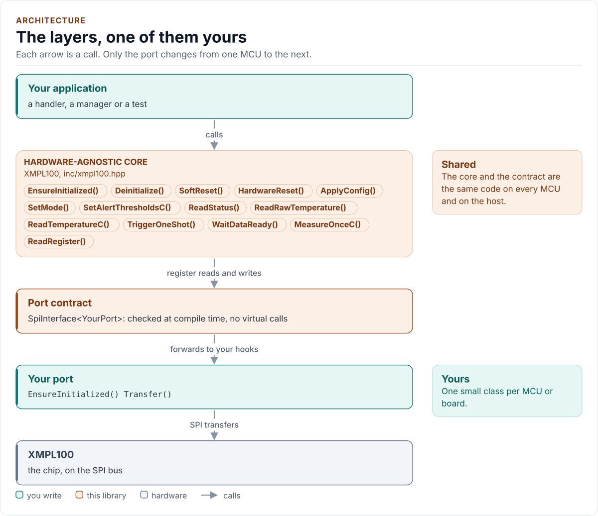
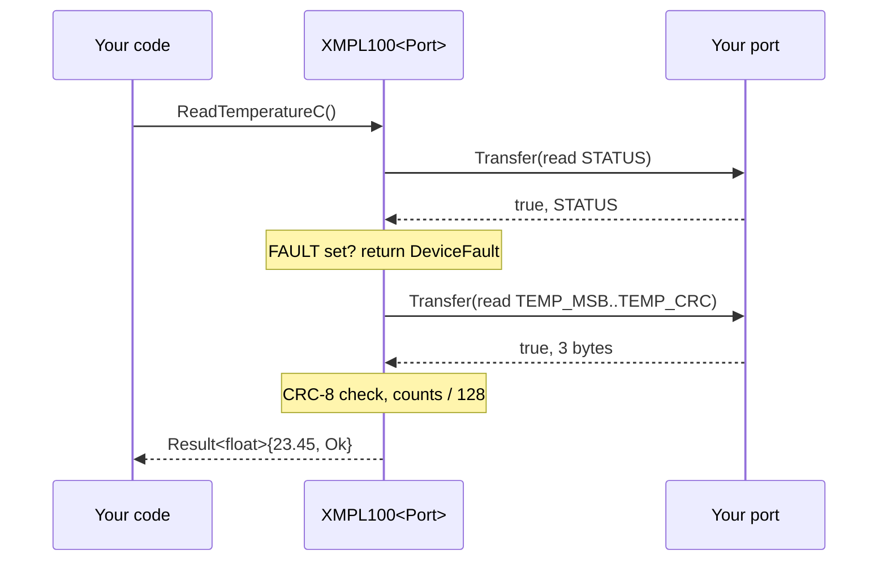

# Architecture

How the driver is built: three layers, one of them yours, and what happens in each when you read a temperature.

<!-- generated: datasheet-refs -->
??? abstract "Datasheet sections this page relies on"

    From Example Corp (fictional) XMPL100-DS A:

    - SPI mode, clock and register framing: 6.2 SPI interface, p. 8
    - Register map and reset values: 7 Register map, p. 11

    All of them, with the driver API for each: [Datasheet map](datasheet.md).
<!-- /generated -->

<!-- figure: driver-layers -->
<picture>
  <source media="(prefers-color-scheme: dark)" srcset="diagrams/driver-layers.dark.svg">
  
</picture>
<!-- /figure -->

## Layers

| Layer | Files | Owns |
| --- | --- | --- |
| Core | [`inc/xmpl100.hpp`](../inc/xmpl100.hpp), [`src/xmpl100.ipp`](../src/xmpl100.ipp) | Lifecycle, configuration, conversions, CRC, timeouts, errors |
| Types and registers | [`inc/xmpl100_types.hpp`](../inc/xmpl100_types.hpp), [`inc/xmpl100_registers.hpp`](../inc/xmpl100_registers.hpp) | `Error`, `Result<T>`, `Config` and presets; the register map |
| Port contract | [`inc/xmpl100_spi_interface.hpp`](../inc/xmpl100_spi_interface.hpp) | The CRTP base, `CtrlPin` and `GpioSignal`, the `SpiPort` concept, the register framing |
| Platform port | Your class | Bus bring-up and byte transfers, optionally delays, the RESET_N pin and logging |
| Kconfig layer | [`inc/xmpl100_kconfig.hpp`](../inc/xmpl100_kconfig.hpp) | Optional: a `Config` from ESP-IDF menuconfig |

## One call through the layers

## Design choices

- **CRTP, not virtual functions.** The port is a template parameter constrained by the `SpiPort` concept, so every
  call is resolved at compile time and a missing hook is a compile error that names it.
- **Optional hooks by `requires`.** `DelayUs`, `GpioSet` and `Log` are detected with C++20 `requires` in one
  place. A missing `DelayUs()` fails to compile, a missing `GpioSet()` falls back to the soft reset, a missing
  `Log()` logs nothing; none is skipped silently.
- **No I/O in the constructor.** Construction cannot fail, so the driver can be a static or a member of a handler.
- **One error type.** `Result<T>` carries a value and an `Error`; nothing throws and nothing returns a bare
  `bool`.
- **No heap, no exceptions, no RTTI, no `std::function`, no `printf`.** The driver is a header-only template with
  no mutable static state.

## Source map

| You want | Read |
| --- | --- |
| The public API | [`inc/xmpl100.hpp`](../inc/xmpl100.hpp) |
| How a call is implemented | [`src/xmpl100.ipp`](../src/xmpl100.ipp) |
| Register addresses and bits | [`inc/xmpl100_registers.hpp`](../inc/xmpl100_registers.hpp) |
| The port contract | [`inc/xmpl100_spi_interface.hpp`](../inc/xmpl100_spi_interface.hpp) |

Next: [Contract](contract.md).
