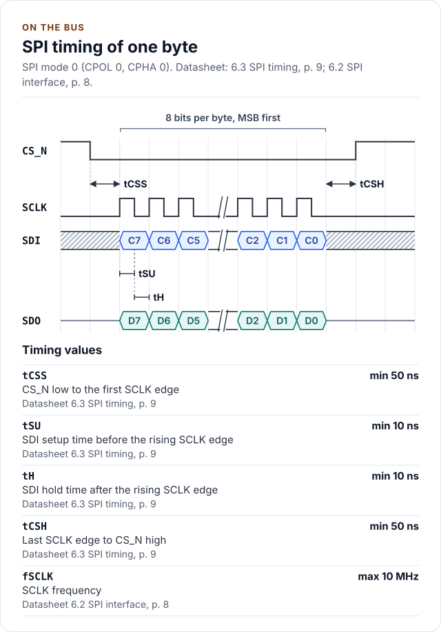

# On the bus

What the XMPL100 needs from the bus, signal by signal, with every time and rate taken from the datasheet. The register
framing is on the [Hardware](hardware.md) page; this page is the waveform under it.

<!-- scaffold:bus-page -->
## SPI timing

The XMPL100 reads SDI on the rising edge of SCLK and changes SDO on the falling edge (mode 0; it also accepts mode 3).
The driver sends one command byte, then reads or writes the data bytes while CS_N stays low.

<!-- figure: bus-timing -->
<picture>
  <source media="(prefers-color-scheme: dark)" srcset="diagrams/bus-timing.dark.svg">
  
</picture>
<!-- /figure -->

## Several devices

The datasheet describes no daisy chain: several XMPL100 on one SPI bus share SCLK, SDI and SDO, and each needs its
own CS_N. When a chip's datasheet describes a chain or a shared bus with addresses, draw it as a `topology` figure:
`kokeb-docs figkit new --kind topology --id bus-topology --page docs/bus.md`.
<!-- /scaffold:bus-page -->

## How these figures are made

Each figure is a model in `docs/model/` (`bus-timing.timing.yml`, and `bus-topology.topology.yml` when the chip
shares a bus) that cites the datasheet section and page of every number; `kokeb-docs figures` draws it and the build
fails on a number without a citation. The values table under each waveform is also written as
`docs/diagrams/<id>.table.html`.
