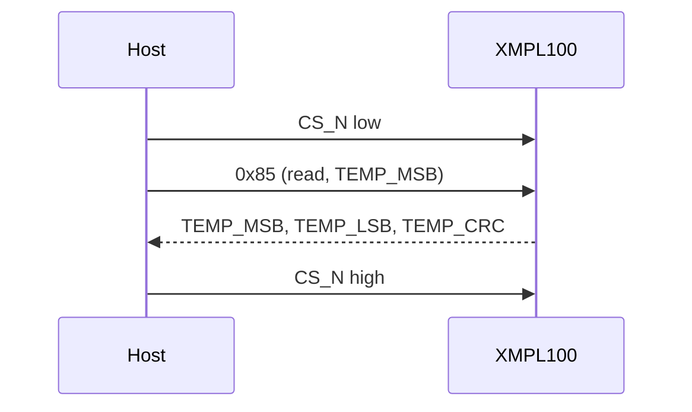

# Hardware

The XMPL100's pins, bus settings, timing and power, as the driver uses them.

<!-- generated: datasheet-refs -->
??? abstract "Datasheet sections this page relies on"

    From Example Corp (fictional) XMPL100-DS A:

    - Pins and package: 3 Pin configuration, p. 3
    - Supply voltage and supply current: 5 Electrical characteristics, p. 5
    - SPI mode, clock and register framing: 6.2 SPI interface, p. 8
    - Chip ID and silicon revision: 7.1 CHIP_ID and REV_ID, p. 11
    - Alert thresholds and the ALERT pin: 7.7 ALERT_HIGH and ALERT_LOW, p. 15
    - CRC-8 of the result: 7.9 CRC, p. 16
    - Power-up time: 8.1 Power-up, p. 17
    - Soft reset and t_RST: 8.2 Soft reset, p. 17
    - Hardware reset (RESET_N) and t_RST_PW: 8.3 Hardware reset, p. 18
    - Conversion time t_CONV: 8.4 Conversion timing, p. 18

    All of them, with the driver API for each: [Datasheet map](datasheet.md).
<!-- /generated -->

## Pins

| Pin | Direction | Function |
| --- | --- | --- |
| VDD | Power | 1.8 V to 3.6 V; 100 nF to GND at the pin |
| GND | Power | |
| RESET_N | In | Hardware reset, active low, internal 100 kΩ pull-up; optional |
| ALERT | Out | Open drain, threshold alert; polarity set by CTRL.ALERT_POL; optional |

<!-- scaffold:bus-pins -->
| Bus pin | Direction | Function |
| --- | --- | --- |
| SCLK | In | SPI clock |
| SDI | In | SPI data in (MOSI) |
| SDO | Out | SPI data out (MISO); high impedance while CS_N is high |
| CS_N | In | Chip select, active low; one frame per low period |
<!-- /scaffold:bus-pins -->

## Control pins

The driver drives RESET_N only through the optional `GpioSet()` hook of your port, with logical levels:
`GpioSignal::ACTIVE` means "in reset", which your port writes as a low level. A board that ties RESET_N high
leaves the hook out: `EnsureInitialized()` then uses the soft reset and `HardwareReset()` returns `Error::Unsupported`.

ALERT is not read by the driver. Wire it to an MCU interrupt and read STATUS (`ReadStatus()`) when it fires.

<!-- scaffold:bus-settings -->
## Bus settings

| Setting | Value |
| --- | --- |
| SPI mode | 0 (CPOL = 0, CPHA = 0) or 3 |
| Clock | Up to 10 MHz |
| Bit order | MSB first |
| Frame | First byte: bit 7 = 1 read, 0 write; bits 6..0 register address. Then the data bytes |
| Burst | The address auto-increments; the driver reads at most 4 bytes per frame |
| Chip select | Low for the whole frame; the chip decodes the frame when CS_N rises |

<!-- /scaffold:bus-settings -->

## Timing

| Parameter | Symbol | Value | Driver |
| --- | --- | --- | --- |
| Power-on to first access | t_PU | 2 ms maximum | Wait before `EnsureInitialized()`; the driver's reset wait covers a later call |
| Reset duration | t_RST | 1 ms maximum, STATUS.BUSY set | `kResetTimeMaxUs`, then STATUS polled |
| RESET_N pulse | t_RST_PW | 10 µs minimum | `kResetPulseMinUs` with `DelayUs()` |
| Conversion | t_CONV | 8 ms typical, 10 ms maximum per sample | `kConversionTimeMaxUs`; limits averaging at 16 Hz |

## Power

| Mode | Supply current (typical) |
| --- | --- |
| Shutdown | 0.5 µA |
| Continuous, 1 Hz, no averaging | 8 µA |
| Continuous, 16 Hz, 4 samples | 210 µA |
| Converting | 400 µA |

`Deinitialize()` puts the chip in shutdown.

## Silicon revisions

| REV_ID | Revision | Difference |
| --- | --- | --- |
| `0x10` | A | No CRC: `crc_enable = true` returns `Error::Unsupported` |
| `0x20` | B | CRC-8 (polynomial 0x31, initial value 0xFF) on TEMP_MSB and TEMP_LSB |

`GetRevision()` returns the value read by `EnsureInitialized()`.

## Reference documents

<!-- scaffold:datasheet -->
The XMPL100 is fictional, and so is its datasheet: the card below and [`docs/datasheets.yml`](datasheets.yml)
describe an imaginary one, with the bus interface in section 6, the register map in section 7 and reset and timing
in section 8. The section numbers on these pages and in the code refer to it.
<!-- /scaffold:datasheet -->

<!-- generated: datasheet-card -->
| Document | Revision | Get it |
| --- | --- | --- |
| Datasheet: XMPL100 Digital Temperature Sensor (Example Corp (fictional) XMPL100-DS) | A, 2026-11-06 | [vendor page](https://example.com/xmpl100) |

Written against these revisions; the SHA-256 of each file is in [`docs/datasheets.yml`](datasheets.yml). Where each part
of the driver is in the datasheet: [Datasheet map](datasheet.md).
<!-- /generated -->

| Also useful | Contents |
| --- | --- |
| [`inc/xmpl100_registers.hpp`](../inc/xmpl100_registers.hpp) | The register map as the driver uses it, with datasheet section numbers |
