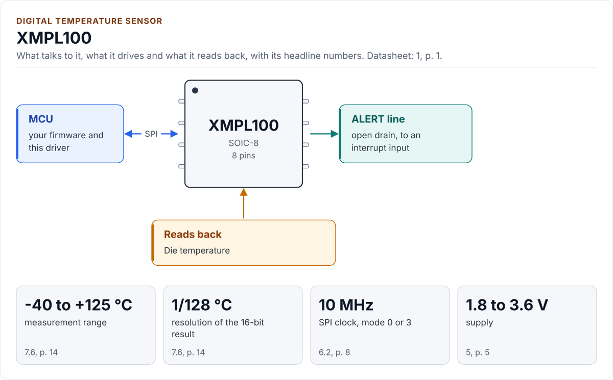
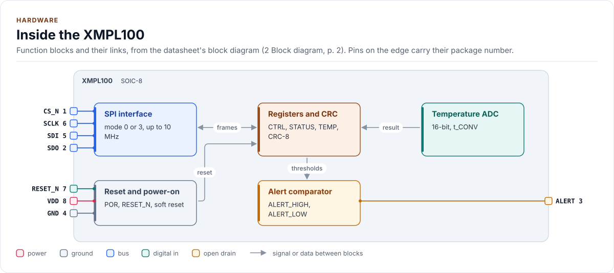
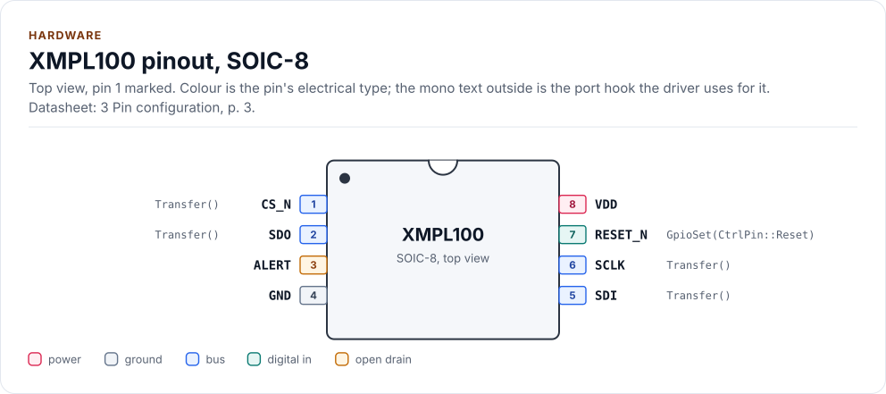
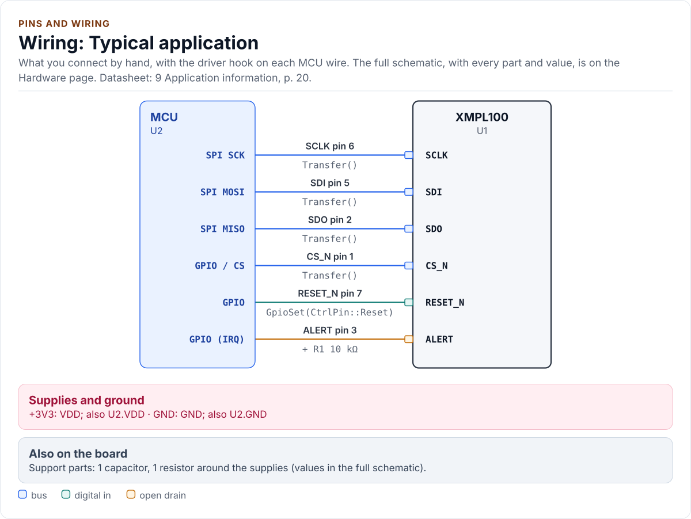
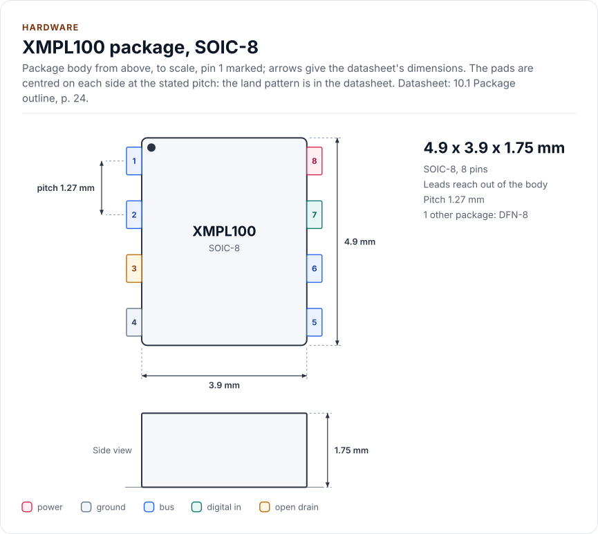
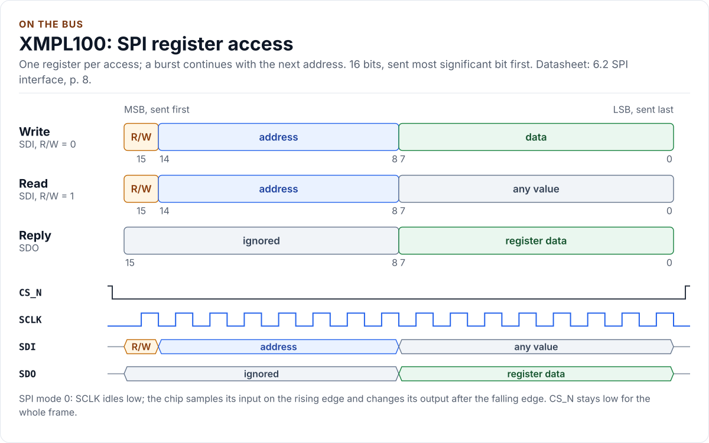

---
hide:
  - navigation
  - toc
---

<div class="kb-hero" markdown>
<span class="kb-kicker">Driver</span>

# XMPL100 Driver

<p>A C++20 driver for the XMPL100 digital temperature sensor. It checks the chip ID, runs continuous or
one-shot conversions, verifies CRC-protected reads and programs the alert thresholds, on any MCU.</p>

[Quickstart](quickstart.md){ .md-button .md-button--primary }
[API guide](api-guide.md){ .md-button }
[Source on GitHub](https://github.com/kokeb-labs/driver-template){ .md-button }
</div>

<!-- generated: chip-summary -->
The **XMPL100** is a digital temperature sensor that measures its own die from -40 °C to +125 °C in steps of 1/128 °C
and pulls an alert line low when the temperature leaves a window you set (1 Features, p. 1).
<!-- /generated -->

<!-- scaffold:remove -->
!!! note "A fictional part"
    The XMPL100 is the fictional example sensor of the driver template. Its register map is realistic, but there is no
    such part: replace it with your chip's datasheet when you create a driver from the template.
<!-- /scaffold:remove -->

<!-- figure: chip-hero -->
<picture>
  <source media="(prefers-color-scheme: dark)" srcset="diagrams/chip-hero.dark.svg">
  
</picture>
<!-- /figure -->

## What it does

<!-- figure: chip-capabilities -->
<picture>
  <source media="(prefers-color-scheme: dark)" srcset="diagrams/chip-capabilities.dark.svg">
  
</picture>
<!-- /figure -->

## Where it is used

<!-- generated: chip-uses -->
- Board and enclosure temperature monitoring
- Thermal protection of power stages
- Battery pack temperature
- Data loggers

Uses named by the datasheet (1 Features, p. 1).
<!-- /generated -->

## Inside the chip

<!-- figure: chip-blocks -->
<picture>
  <source media="(prefers-color-scheme: dark)" srcset="diagrams/chip-blocks.dark.svg">
  
</picture>
<!-- /figure -->

## Pins and wiring

<!-- figure: chip-pinout -->
<picture>
  <source media="(prefers-color-scheme: dark)" srcset="diagrams/chip-pinout.dark.svg">
  
</picture>
<!-- /figure -->

<!-- figure: chip-wiring-typical -->
<picture>
  <source media="(prefers-color-scheme: dark)" srcset="diagrams/chip-wiring-typical.dark.svg">
  
</picture>
<!-- /figure -->

<!-- figure: chip-outline -->
<picture>
  <source media="(prefers-color-scheme: dark)" srcset="diagrams/chip-outline.dark.svg">
  
</picture>
<!-- /figure -->

<!-- figure: chip-frame-spi -->
<picture>
  <source media="(prefers-color-scheme: dark)" srcset="diagrams/chip-frame-spi.dark.svg">
  
</picture>
<!-- /figure -->

<div class="kb-chip" markdown>
<div class="kb-chip__head">
<span class="kb-chip__kicker">Digital temperature sensor</span>
<span class="kb-chip__name">XMPL100</span>
<span class="kb-chip__vendor">Fictional example sensor</span>
</div>

Function
:   Die temperature, -40 °C to +125 °C, 16-bit result at 1/128 °C per count

<!-- scaffold:bus-interface -->
Interface
:   SPI mode 0 or 3, up to 10 MHz; 7-bit register addresses, auto-increment
<!-- /scaffold:bus-interface -->

Conversions
:   Continuous at 1 Hz to 16 Hz, or one-shot; averaging of 1 to 8 samples

Integrity
:   CRC-8 on every result (revision B silicon); STATUS.FAULT for an open or shorted element

Alert
:   High and low thresholds on an open-drain ALERT pin, either polarity

Supply
:   1.8 V to 3.6 V
</div>

Every pin, the reference circuits, the bus settings, the timing and the power: [Hardware](hardware.md).

## Quick start

Wire the chip as above, write the port for your MCU ([Porting](porting.md)), then:

<!-- generated: quickstart-code -->
```cpp
#include "xmpl100.hpp"

int read_board_temperature(MyPort& port, float& celsius) {
  xmpl100::XMPL100<MyPort> sensor(port); // no I/O yet

  if (auto r = sensor.EnsureInitialized(); !r) { // 1. bus up, reset, CHIP_ID, Config{}
    return static_cast<int>(r.error); //    Bus, Timeout or DeviceIdMismatch: check wiring
  }
  const auto t = sensor.ReadTemperatureC(); // 2. latest continuous result
  if (!t) {
    return static_cast<int>(t.error); //    DeviceFault: sensing element open or shorted
  }
  celsius = t.value; // 3. degrees Celsius, 1/128 °C resolution
  return 0;
}
```
<!-- /generated -->

Every step, with the port and what to check when it does not work: [Quickstart](quickstart.md).

## Driver coverage

<!-- generated: chip-coverage -->
| Capability | What the chip does | Driver API | Registers | Status | Datasheet |
| --- | --- | --- | --- | --- | --- |
| [Temperature](api-guide.md) | Measures the die temperature as a 16-bit result, 1/128 °C per count | `ReadTemperatureC`, `ReadRawTemperature` | `TEMP_MSB`, `TEMP_LSB` | Supported | 7.6, p. 14 |
| [Continuous and one-shot](api-guide.md) | Converts continuously at a chosen rate, or once on request to save power | `SetMode`, `TriggerOneShot`, `WaitDataReady`, `MeasureOnceC` | `CTRL`, `CONFIG` | Supported | 7.4, p. 13 |
| [Alert window](hardware.md) | Pulls the open-drain ALERT pin low outside a high and a low threshold | `SetAlertThresholdsC`, `ReadStatus` | `ALERT_HIGH`, `ALERT_LOW`, `STATUS` | Supported | 7.7, p. 15 |
| [Result CRC](api-guide.md) | Protects each result with a CRC-8 on revision B silicon | `ReadTemperatureC` | `TEMP_CRC` | Supported | 7.9, p. 16 |
| [Offset trim](api-guide.md) | Shifts every result by a signed offset, 1/16 °C per count | `ApplyConfig` | `OFFSET` | Supported | 7.8, p. 15 |
| [Reset and identity](hardware.md) | Soft or hardware reset, then a chip ID and revision check before anything else | `EnsureInitialized`, `SoftReset`, `HardwareReset` | `CHIP_ID`, `REV_ID` | Supported | 8.3, p. 18 |

**Supported**: the driver covers it and a host test checks it.

From [`docs/hardware.yml`](hardware.yml); `kokeb-docs hardware --check` confirms that every API name is in
`inc/xmpl100.hpp` and every register in `inc/xmpl100_registers.hpp`.
<!-- /generated -->

The driver has no platform code. You give it a small class that brings the bus up and moves bytes; it does the rest: the
reset sequence, the chip-ID check, register framing, unit conversion, CRC checks and timeouts.

## What you get

- **One object per chip.** `XMPL100<YourPort>` takes a reference to your port and does no I/O until
  `EnsureInitialized()`. See [API guide](api-guide.md).
- **Errors you can act on.** Every call returns `Result<T>` with an `Error` such as `Bus`, `Timeout` or
  `DeviceIdMismatch`. See [API guide](api-guide.md#handle-errors).
- **Datasheet defaults.** `Config{}` holds the chip's reset values, with units in the field names, plus three
  presets. See [Configuration](configuration.md).
- **Zero-overhead portability.** The port is a CRTP class checked by a concept: the bus hooks and a delay, plus
  optional RESET_N and logging hooks found at compile time. See [Porting](porting.md).
- **No heap, no exceptions, no RTTI.** The host tests build with `-fno-exceptions -fno-rtti`. See
  [Contract](contract.md).
- **Tested without hardware.** Host tests run the driver against a register model of the chip. See
  [Testing and CI](testing.md).

## Datasheet

<!-- generated: datasheet-card -->
| Document | Revision | Get it |
| --- | --- | --- |
| Datasheet: XMPL100 Digital Temperature Sensor (Example Corp (fictional) XMPL100-DS) | A, 2026-11-06 | [vendor page](https://example.com/xmpl100) |

Written against these revisions; the SHA-256 of each file is in [`docs/datasheets.yml`](datasheets.yml). Where each part
of the driver is in the datasheet: [Datasheet map](datasheet.md).
<!-- /generated -->

## Where to go next

<div class="grid cards" markdown>

-   :material-rocket-launch-outline: **[Quickstart](quickstart.md)**

    ---

    Wire the chip, write the port, read a temperature in about 15 lines.

-   :material-chip: **[Hardware](hardware.md)**

    ---

    Pins, bus settings, timing and power.

-   :material-file-document-check-outline: **[Contract](contract.md)**

    ---

    What the driver promises, what it needs, threading and errors.

-   :material-code-braces: **[API guide](api-guide.md)**

    ---

    Initialise, configure, measure and handle errors, task by task.

-   :material-swap-horizontal: **[Porting](porting.md)**

    ---

    Implement the port for your MCU.

-   :material-book-open-variant: **[API reference](api-reference.md)**

    ---

    Every class and member, generated from the headers.

</div>
