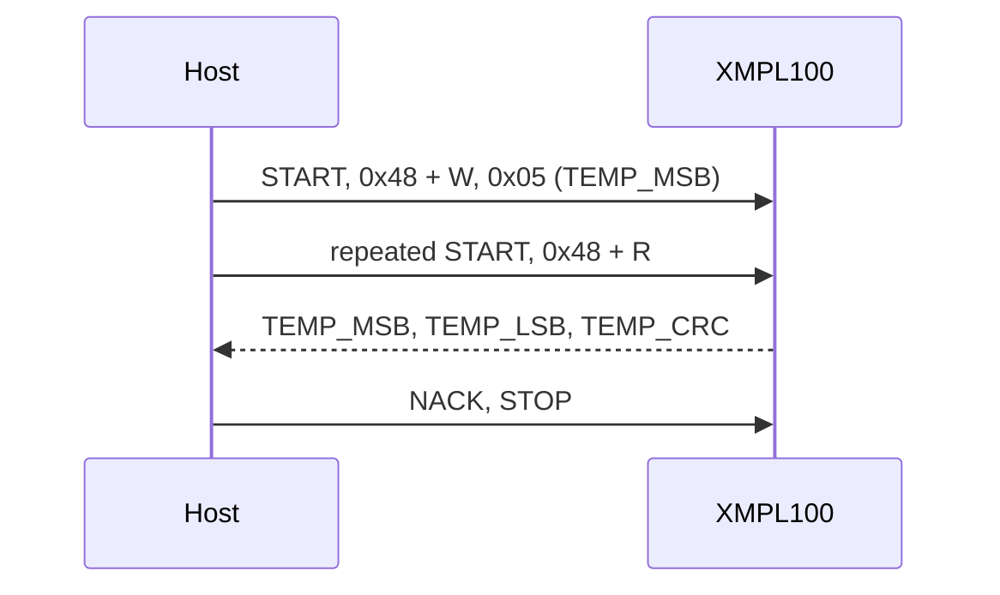

## Bus settings

| Setting | Value |
| --- | --- |
| Clock | Standard mode (100 kHz) or fast mode (400 kHz) |
| Address | 7-bit, `0x48` to `0x4B` from ADDR; pass it to the constructor |
| Write | START, address + W, register, data bytes, STOP |
| Read | START, address + W, register, repeated START, address + R, data bytes, STOP |
| Burst | The register address auto-increments; the driver reads at most 4 bytes per transaction |

