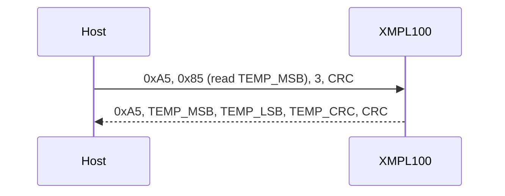

## Bus settings

| Setting | Value |
| --- | --- |
| Format | 115200 baud, 8 data bits, no parity, 1 stop bit |
| Request | `0xA5`, command (`0x80` + register for a read, the register for a write), length, data (writes), CRC-8 |
| Read reply | `0xA5`, data bytes, CRC-8 of the data |
| Write reply | `0xA5`, `0x06` (ACK) |
| CRC | CRC-8, polynomial 0x31, initial value 0xFF, over everything after `0xA5` |
| Reply time | 5 ms maximum (t_REPLY); a missing reply is `Error::Timeout` |

